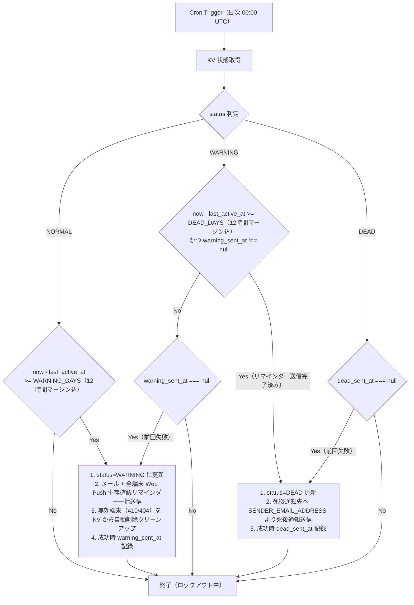

# Dead Man's Switch アーキテクチャ・詳細設計書

## 1. 技術スタック

| 区分 | 採用技術 / サービス | 用途・詳細 |
| :--- | :--- | :--- |
| **開発言語** | TypeScript (v6) | 型安全な Worker 実装 |
| **Web フレームワーク** | Hono / Hono JSX (v4) | ルーティング、JSX SSR レンダリング、RPC（型安全 API） |
| **ビルドツール** | Vite (v8) | Workers およびクライアントアセットの本番ビルド（`@cloudflare/vite-plugin`） |
| **バリデーション** | Zod (v4) + `@hono/zod-validator` | リクエストデータのスキーマ検証・自動型推論 |
| **認証・アクセス制御** | Cloudflare Zero Trust | 全パス保護（本人認証: Google/Passkey、外部API認証: Service Tokens） |
| **実行基盤** | Cloudflare Workers | サーバーレスランタイム (Wrangler v4, `nodejs_compat`) |
| **静的アセット配信** | Cloudflare Workers Static Assets | `public/sw.js`（Service Worker）、`public/style.css`、Vite クライアントアセット |
| **ストレージ** | Cloudflare KV | 状態・タイムスタンプ・Web Push 配信先情報の保存 |
| **定時実行** | Cloudflare Cron Triggers | 日次判定処理 (`0 0 * * *`) |
| **本人通知** | Cloudflare Email Service + Web Push | 生存確認リマインダー配信（メール + 全端末への Web Push 同時配信） |
| **死後通知** | Cloudflare Email Service | 死後通知自動送信（Email Sending 機能） |
| **テスト** | Vitest + Workers Pool | 状態遷移・API 自動テスト |

## 2. ディレクトリ構成

```text
dead-mans-switch/
├── README.md                  # 概要と環境構築・デプロイ手順
├── docs/
│   ├── REQUIREMENTS.md        # 要件定義書
│   └── ARCHITECTURE.md        # アーキテクチャ・詳細設計書（本書）
├── package.json               # 依存関係定義
├── tsconfig.json              # TypeScript設定
├── vite.config.ts             # Vite + Cloudflare 開発・ビルド設定
├── wrangler.jsonc.example     # 設定・非機密環境変数テンプレート（wrangler.jsonc は git 管理対象外）
├── vitest.config.ts           # Vitest 設定
├── public/
│   ├── style.css              # 生存確認・ロックアウト画面用スタイルシート
│   └── sw.js                  # Service Worker（Web Push 受信 & / 画面起動、Workers Assets で自動配信）
├── src/
│   ├── index.tsx              # メインエントリポイント（Hono API + jsxRenderer + Cron）
│   ├── client.tsx             # ブラウザ専用ハイドレーションエントリ
│   ├── types.ts               # 型定義（SystemLockedError・PushSubscriptionLimitError 等）
│   ├── lib/
│   │   └── island.tsx         # <Island> コンポーネント
│   ├── islands/               # CSR コンポーネント
│   │   └── CheckInContent.tsx
│   ├── pages/                 # SSR ページコンポーネント
│   │   ├── CheckIn.tsx        # 生存確認画面 SSR ページ
│   │   └── Dead.tsx           # 死後通知送信完了（システムロックアウト） SSR ページ
│   ├── utils/
│   │   └── date.ts            # 日付・時間計算ユーティリティ
│   └── services/
│       ├── push.ts            # Web Push (VAPID) 送信モジュール
│       ├── email.ts           # メール送信モジュール
│       ├── kv.ts              # KV 操作モジュール
│       └── cron.ts            # 定時チェック・判定・無効端末クリーンアップモジュール
├── scripts/
│   ├── cli.ts                 # メール送信・ステータスシミュレーションテスト CLI ツール
│   └── cli.test.ts            # CLI ツール単体テスト（Node.js 環境）
└── test/
    ├── index.test.ts          # システム・API 自動テスト
    ├── services/
    │   └── email.test.ts      # メール処理モジュール単体テスト（宛先解析・複数宛先送信）
    └── utils/
        └── date.test.ts       # 日付ユーティリティ単体テスト
```

## 3. KV データ設計（`DMS_KV`）

| キー | 型 / 値の範囲 | 説明 |
| :--- | :--- | :--- |
| `status` | `"NORMAL"` \| `"WARNING"` \| `"DEAD"` | システムの現在状態 |
| `last_active_at` | ISO 8601 文字列 | 最終生存確認日時 |
| `warning_sent_at` | ISO 8601 文字列 \| `null` | 生存確認リマインダー成功日時 |
| `dead_sent_at` | ISO 8601 文字列 \| `null` | 死後通知送信成功日時（リトライ判定用） |
| `push_subscriptions` | JSON 配列 (`PushSubscription[]`) | 登録済み複数端末の Web Push 購読情報リスト |

## 4. エンドポイント & Cloudflare Zero Trust 設計

### 4.1. Access controls

Cloudflare Dashboard > **Zero Trust** > **Access controls** にて、Worker のドメイン全体（全パス）を1つのアプリケーションで保護し、以下の2つのポリシーを適用する。

| ポリシー | アクション | 許可対象 |
| :--- | :--- | :--- |
| **本人用ポリシー**（例: `Allow My Email`） | **Allow** | 本人確認（メールアドレス等）を通過したユーザー |
| **外部スクリプト用ポリシー** | **Service Auth** | Service Token (`CF-Access-Client-Id` / `CF-Access-Client-Secret`) を付与したリクエスト |

ポリシーはパス単位ではなくドメイン全体に適用されるため、いずれの方法で認証しても全エンドポイントへ到達できる。各エンドポイントの想定利用元は以下のとおり。

| パス / エンドポイント | 想定利用元 |
| :--- | :--- |
| **`GET /`** | 本人（ブラウザ） |
| **`POST /api/push/subscribe`** | 本人（ブラウザ） |
| **`DELETE /api/push/subscribe`** | 本人（ブラウザ） |
| **`POST /api/ping`** | 本人（ブラウザ）、外部スクリプト（Service Token 認証） |
| **`GET /api/status`** | 本人（ブラウザ）、外部スクリプト（Service Token 認証）。デバッグ・外部状態監視用 |

※ `public/sw.js` は Workers Static Assets（`wrangler.jsonc` の `"assets": { "directory": "./public" }`）により Hono 側を経由せず静的に自動配信される。

### 4.2. API 詳細仕様

#### 1. `GET /`（生存確認画面）

- **認証**: Cloudflare Zero Trust
- **処理**:
  - `status === "DEAD"` の場合: 「死後通知送信済み（システムロックアウト中）」のメッセージ画面を返却し、復帰ボタン・Web Push 登録操作を完全に無効化する。
  - `status !== "DEAD"` の場合: 現在のステータス（`status`）、最終生存確認日時（`last_active_at`）、警告までの経過日数、Web Push 購読状況を表示する HTML 画面を返却。
    - 「生存報告を行う」ボタン押下で `POST /api/ping` を呼び出し `NORMAL` へ復帰・`last_active_at` を更新。
    - 「この端末の Web Push 通知を許可」ボタン押下で Web Push サブスクリプションを取得し `POST /api/push/subscribe` へ送信。
    - 「この端末の Web Push 通知登録を解除」ボタン押下で `DELETE /api/push/subscribe` へ送信。
- **レスポンス**: `200 OK` (Content-Type: `text/html; charset=utf-8`)

#### 2. `POST /api/ping`（生存報告・生存シグナル受信）

- **認証**: Cloudflare Zero Trust (Service Token 認証 または Access ユーザー認証)
- **処理**:
  1. `status === "DEAD"` の場合は `403 Forbidden` (`{"error": "System locked out (status is DEAD)"}`) を返却。
  2. `last_active_at` を現在時刻に更新。
  3. `WARNING` 状態の場合は `NORMAL` へ復帰し、`warning_sent_at` を `null` にクリーンアップ。
- **レスポンス**: `200 OK` (`{"success": true, "status": "NORMAL", "last_active_at": "..."}`)

#### 3. `POST /api/push/subscribe`（Web Push サブスクリプション保存・複数端末対応）

- **認証**: Cloudflare Zero Trust
- **処理**:
  1. 受信した `PushSubscription` オブジェクトを取得。
  2. KV の `push_subscriptions`（配列）を取得。既存の配列内に同 `endpoint` が存在すれば最新データに更新し、存在しなければ配列に追加（最大20件制限）。
  3. 更新された配列を KV に保存。
- **レスポンス**: `200 OK` (`{"success": true, "total_devices": 2}`)。新規端末の追加で上限を超える場合は `409 Conflict` (`{"error": "Push subscriptions limit exceeded (max 20)"}`)

#### 4. `DELETE /api/push/subscribe`（Web Push サブスクリプション削除）

- **認証**: Cloudflare Zero Trust
- **処理**:
  1. 受信した JSON 内の `endpoint` を取得。
  2. KV の `push_subscriptions` 配列から対象 `endpoint` のサブスクリプションを削除して KV を更新。
- **レスポンス**: `200 OK` (`{"success": true, "total_devices": 1}`)

#### 5. `GET /api/status`（状態確認 API）

- **認証**: Cloudflare Zero Trust (Service Token 認証 または Access ユーザー認証)
- **レスポンス**: `200 OK` (`{"status": "NORMAL", "days_since_active": 0, ...}`)

### 4.3. エラーハンドリング・入力検証アーキテクチャ

システム全体の一貫性とセキュリティを保持するため、以下の統一されたエラーハンドリング機構を適用する。

1. **Zod によるリクエスト検証エラー（`400 Bad Request`）**:
   - `@hono/zod-validator` ミドルウェアにより、`POST /api/push/subscribe` および `DELETE /api/push/subscribe` のリクエストボディ形式を厳密に検証する。
   - スキーマ不一致時はハンドラー実行前に `400 Bad Request`（`{"success": false, "error": ...}`）を自動返却する。
2. **システムロックアウト例外（`403 Forbidden`）**:
   - システムステータスが `DEAD` の状態において生存報告操作（`updateActivity`）が行われた場合、KV サービス層で `SystemLockedError` カスタム例外を発生させる。
   - Hono の `app.onError()` グローバルエラーハンドラーが本例外をキャッチし、一貫して `403 Forbidden` (`{"error": "System locked out (status is DEAD)"}`) レスポンスへ変換して返却する。
3. **Web Push 登録端末数の上限超過（`409 Conflict`）**:
   - 登録端末数が上限（20件）に達した状態で新規端末を追加しようとした場合、KV サービス層で `PushSubscriptionLimitError` カスタム例外を発生させ、`app.onError()` で `409 Conflict`（`{"error": "Push subscriptions limit exceeded (max 20)"}`）へ変換して返却する。
4. **Hono の HTTP 例外（`4xx`）**:
   - 不正な JSON ボディ等で Hono が送出する `HTTPException` は、`app.onError()` でそのステータスのまま返却する（例: `400 Bad Request`（`{"error": "Malformed JSON in request body"}`））。
5. **予期しない例外（`500 Internal Server Error`）**:
   - 上記以外の例外は `console.error` でログ出力したうえで `500 Internal Server Error`（`{"error": ...}`）を返却する。

## 5. 定期実行処理（Cron Trigger）と状態遷移

Cron 実行時刻とハートビート送信時刻の誤差による判定遅延を防ぐため、生存確認リマインダー（`WARNING_DAYS * 86400 - 43200` 秒）および死後処理（`DEAD_DAYS * 86400 - 43200` 秒）の両方に **12時間マージン** を適用する。

Web Push 送信時には登録されている全端末（`push_subscriptions`）へ並行一括送信（`Promise.all`）を行い、エラー応答（404 Not Found または 410 Gone）が返った期限切れ無効端末は KV 配列から自動削除（クリーンアップ）する。



## 6. メール送信モジュール設計

Cloudflare Workers の `send_email` バインディング（`env.SEND_EMAIL`）を利用したメール送信モジュール。具体的な実装コードについては [src/services/email.ts](../src/services/email.ts) を参照。

- **送信元メールアドレス**: Cloudflare 上で所有・管理（Email Routing 設定済み）しているカスタムドメインのアドレス `SENDER_EMAIL_ADDRESS`（例: `noreply@yourdomain.com`）を使用する。
- **完全無料（$0）仕様**: Cloudflare Dashboard > **Email Routing** > **Destination Addresses** にて事前認証（Verify）が完了している送信先メールアドレス（本人通知先 `OWNER_EMAIL_ADDRESS` および死後通知先 `KIN_EMAIL_ADDRESS`）宛てに送信する場合、Workers Free プランを含むすべてのプランで送信数上限のカウント対象外（完全無料）で直接送信可能。
- **複数宛先配信・エラー処理**: `OWNER_EMAIL_ADDRESS` および `KIN_EMAIL_ADDRESS` は区切り文字（カンマ・セミコロン）で複数指定可能。パース・重複排除のうえ `Promise.allSettled` で並列送信し、1件以上の成功で送信完了日時（`warning_sent_at` / `dead_sent_at`）を記録する（失敗した宛先はエラーログを出力）。
- **単一責任設計**: `sendEmail` 関数は `env.SEND_EMAIL`（送信バインディング）のみを引数として受け取り、環境変数全体（`Env`）に依存しない独立モジュールとして動作する。本文中のプレースホルダー（`${BASE_URL}` 等）の動的置換は呼び出し側で行う。

## 7. 設定・環境変数設計

本プロジェクトの運用環境変数は、すべて [wrangler.jsonc](../wrangler.jsonc)（Git 管理対象外）の `vars` セクションにて一元管理される。

### 環境変数（`vars`）一覧

- `BASE_URL`: システムの展開先 URL（生存確認画面 URL の組み立てに使用）
- `SENDER_EMAIL_ADDRESS`: 送信元メールアドレス
- `VAPID_SUBJECT`: Web Push VAPID 連絡先（例: `mailto:owner@example.com`）
- `OWNER_EMAIL_ADDRESS`: 本人通知先メールアドレス（生存確認リマインダーの受取先、カンマ区切りで複数指定可能）
- `KIN_EMAIL_ADDRESS`: 死後通知先メールアドレス（手続案内・メッセージの受取先、カンマ区切りで複数指定可能）
- `VAPID_PUBLIC_KEY` / `VAPID_PRIVATE_KEY`: Web Push 送信・認証用 VAPID 鍵ペア
- `WARNING_DAYS`: 生存確認リマインダーを発動する不活動日数（デフォルト: 7日）
- `DEAD_DAYS`: 死後処理を発動する通算不活動日数（デフォルト: 14日）
- `WARNING_EMAIL_SUBJECT` / `WARNING_EMAIL_BODY`: 生存確認リマインダーメールの件名および本文テンプレート
- `DEAD_EMAIL_SUBJECT` / `DEAD_EMAIL_BODY`: 死後通知メールの件名および本文テンプレート

### 公開範囲・可観測性の設定

- `preview_urls: false`: Preview URL（`<version>-<name>.<subdomain>.workers.dev`）を無効化する。Access アプリケーションは `<name>.<subdomain>.workers.dev` のみを保護対象とするため、Preview URL を有効にすると認証なしで全エンドポイントへ到達できてしまう。未指定の場合、`wrangler deploy` 時に workers.dev の有効状態に合わせて Preview URL が有効化されるため、明示的に `false` を指定する。
- `observability.enabled: true`: Workers Logs を有効化し、Cron の通知送信失敗や予期しない例外の `console.error` を保存する。

設定ファイルのテンプレート（[wrangler.jsonc.example](../wrangler.jsonc.example)）およびセットアップ手順の詳細については [README.md](../README.md) を参照。

## 8. CLI ツール設計

Wrangler CLI 経由で KV 状態の更新やメール送信シミュレーションを行う CLI ツール（[scripts/cli.ts](../scripts/cli.ts)）。

### 8.1. コマンド一覧

| コマンド | 説明 |
| :--- | :--- |
| `pnpm cli status` | 現在の KV 内システムデータを整形表示 |
| `pnpm cli ping` | 生存シグナルを送信し `NORMAL` 状態へ安全復帰 |
| `pnpm cli warning` | `WARNING`（警告リマインダー送信）シミュレーションを実行 |
| `pnpm cli dead` | `DEAD`（死後通知送信）シミュレーションを実行 |
| `pnpm cli reset` | ステータスを `NORMAL` 状態へ初期化リセット |

### 8.2. 安全設計

- **STDOUT / STDERR の分離**: パイプライン処理（`pnpm cli status | jq` 等）を破壊しないよう、JSON 状態データのみを STDOUT に出力し、ログ・ヘルプ等はすべて STDERR に出力。
- **設定ファイル自動読み込み**: `wrangler.jsonc` 内の `vars`（`WARNING_DAYS` / `DEAD_DAYS`）を読み込んでシミュレーション日数を算出。
- **誤操作防止・CI ガード**: リモート（`--remote`）実行時は変更差分を表示し実行確認。非 TTY（CI 等）環境では `--yes`（`-y`）なしの実行を自動ブロック。
- **依存モジュール制限**: ESLint（`no-restricted-imports`）により `scripts/` からの `src/` 依存を `@/types` および `@/utils` に限定。
- **エラーハンドリング**: エラー表示を `[ERROR]` に統一し、POSIX 準拠の終了コード（exit code 2 等）を返却。
- **補助機能**: `--dry-run` による事前確認、`-v` / `--version` でのバージョン表示、`-h` / `--help` でのヘルプ表示に対応。

## 9. Island アーキテクチャ設計

Cloudflare Workers での高速な初期描画（SSR）とブラウザでの動的操作（CSR）を両立するため、**Island アーキテクチャ（部分ハイドレーション）**を採用する。

### 9.1. 動作原理

1. **サーバーサイドレンダリング（SSR）**:
   - `src/pages/` 内で `<Island name="..." props={...}>` を配置。
   - `src/lib/island.tsx` の `<Island>` ラッパーがレジストリ（`islands`）から対象コンポーネントを取得して自動描画し、`data-island`（コンポーネント識別子）および `data-props`（JSON 化済み Props）を持つ `<div>` コンテナを出力。
2. **クライアントサイドハイドレーション（CSR）**:
   - `src/client.tsx` が `[data-island]` ノードを検索。
   - `data-island-mounted="true"` により二重マウントを防止し、`data-props` から JSON を復元。
   - レジストリ（`islands`）から該当コンポーネントを取得し `render` マウントを実行。マウント完了後に不要となった `data-props` を DOM から削除（クリーンアップ）。個別 `try-catch` によりエラーを隔離。

### 9.2. 新規 Island コンポーネントの追加手順

1. **コンポーネント作成**: `src/islands/` 配下に JSX コンポーネントを定義。
2. **レジストリ登録**: `src/lib/island.tsx` の `islands` オブジェクトへ登録。
3. **ページ側での呼び出し**: SSR ページ（`src/pages/`）にて `<Island name="..." props={...}>` を呼び出す。

### 9.3. 設計上の制約事項

軽量性と保守性を優先したシンプル実装のため、以下の制約事項が存在する：

- **Island のネスト不可**: 親 Island の内部に子 Island を配置する構造は未サポート（親のクライアント描画時に内部 DOM が初期化され、子 Island のマウントが破壊されるため、Island は常にフラットに配置すること）。
- **後発動的 DOM の手動マウント**: 初期表示（`DOMContentLoaded` / 即時実行）以降に、クライアントサイドで動的に `[data-island]` ノードを DOM 追記した場合は自動検知されない（後から追加したノードを有効化するには `mountIslands()` の手動呼び出しが必要）。
