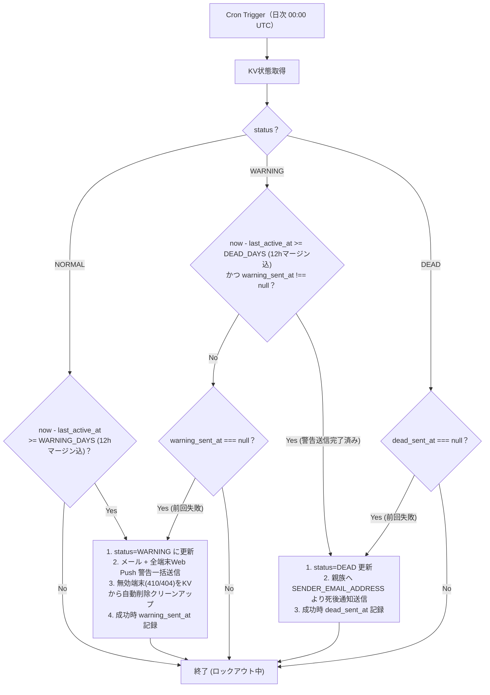

# Dead Man's Switch アーキテクチャ・詳細設計書

## 1. 技術スタック

| 区分                   | 採用技術 / サービス                   | 用途・詳細                                              |
| :--------------------- | :------------------------------------ | :------------------------------------------------------ |
| **開発言語**           | TypeScript (v6.x)                     | 型安全なWorker実装                                      |
| **フレームワーク**     | Hono (v4.x)                           | 軽量Webフレームワーク                                   |
| **認証・アクセス制御** | Cloudflare Zero Trust (Access)        | `/checkin` Web ページの本人認証・保護（Google/Passkey） |
| **実行基盤**           | Cloudflare Workers                    | サーバーレスランタイム (Wrangler v4, `nodejs_compat`)   |
| **静的アセット配信**   | Cloudflare Workers Static Assets      | `public/sw.js` (Service Worker) の静的自動配信          |
| **ストレージ**         | Cloudflare KV (`DMS_KV`)              | 状態・タイムスタンプ・複数端末 Web Push サブスク保存    |
| **定時実行**           | Cloudflare Cron Triggers              | 日次判定処理 (`0 0 * * *`)                              |
| **本人通知**           | Email Send + Web Push (VAPID / SW)    | 一次警告配信（メール + 全端末への Web Push 同時配信）   |
| **死後通知**           | Cloudflare Email Send (Email Routing) | 親族宛て死後通知自動送信                                |
| **テスト**             | Vitest + Workers Pool                 | 状態遷移・API自動テスト                                 |

---

## 2. ディレクトリ構成

```text
dead-mans-switch/
├── README.md                 # 概要と環境構築・デプロイ手順
├── docs/
│   ├── REQUIREMENTS.md       # 要件定義書
│   ├── ARCHITECTURE.md       # アーキテクチャ・詳細設計書（本書）
│   └── 進め方.md             # 実装ロードマップと進め方ガイド
├── package.json              # 依存関係定義
├── tsconfig.json             # TypeScript設定
├── wrangler.jsonc            # 設定・非機密環境変数（Cloudflare 推奨形式）
├── vitest.config.ts          # Vitest 設定
├── public/
│   └── sw.js                 # Service Worker（Web Push 受信 & /checkin 画面起動、Workers Assets で自動配信）
├── src/
│   ├── index.ts              # メインエントリポイント（Hono API + Cron）
│   ├── types.ts              # 型定義
│   ├── templates/
│   │   └── checkin.ts        # ダッシュボード・ロックアウト画面 HTML テンプレート
│   └── services/
│       ├── push.ts           # Web Push (VAPID) 送信モジュール
│       ├── email.ts          # メール送信モジュール（Cloudflare Email Send）
│       ├── kv.ts             # KV 操作モジュール
│       └── cron.ts           # 定時チェック・判定・無効端末クリーンアップモジュール
└── test/
    └── index.test.ts         # 自動テスト
```

---

## 3. KV データ設計（`DMS_KV`）

| キー                 | 型 / 値の範囲                         | 説明                                       |
| :------------------- | :------------------------------------ | :----------------------------------------- |
| `status`             | `"NORMAL"` \| `"WARNING"` \| `"DEAD"` | システムの現在状態                         |
| `last_active_at`     | ISO 8601 文字列                       | 最終アクティブ日時                         |
| `warning_sent_at`    | ISO 8601 文字列 \| `null`             | 一次警告通知成功日時                       |
| `dead_sent_at`       | ISO 8601 文字列 \| `null`             | 死後通知送信成功日時（リトライ判定用）     |
| `push_subscriptions` | JSON 配列 (`PushSubscription[]`)      | 登録済み複数端末の Web Push 購読情報リスト |

---

## 4. エンドポイント & Cloudflare Zero Trust ルーティング設計

### 4.1. Access ルーティング定義

Cloudflare Dashboard の Zero Trust > Access 設定にて以下のルールを適用します。

| パス / エンドポイント            | 認証制御                       | 詳細                                                                      |
| :------------------------------- | :----------------------------- | :------------------------------------------------------------------------ |
| **`GET /checkin`**               | **Protect (Access 認証必須)**  | 本人の Google アカウント / Passkey 認証を通したユーザーのみアクセス許可。 |
| **`POST /checkin/ping`**         | **Protect (Access 認証必須)**  | ダッシュボードからの手動 Ping 用。PING_SECRET_TOKEN 不要。                |
| **`POST /api/push/subscribe`**   | **Protect (Access 認証必須)**  | 本人端末からのみ Web Push 登録を許可。                                    |
| **`DELETE /api/push/subscribe`** | **Protect (Access 認証必須)**  | 本人端末からの Web Push 登録解除を許可。                                  |
| **`POST /api/ping`**             | **Bypass (X-Ping-Token 認証)** | 外部スクリプト等からの自動 Ping 用に Bypass 設定。ヘッダーで認証。        |
| **`GET /api/status`**            | **Bypass (X-Ping-Token 認証)** | デバッグ・外部状態監視用。ヘッダー認証。                                  |

※ `public/sw.js` は Workers Static Assets (`assets = { directory = "./public" }`) により Hono 側を経由せず静的に自動配信されます。

### 4.2. API 詳細仕様

#### 1. `GET /checkin`（生存確認・ステータス確認画面）

- **認証**: Cloudflare Zero Trust (Access)
- **処理**:
  - `status === "DEAD"` の場合: 「死後処理完了済み（システムロックアウト中）」のメッセージ画面を返却し、復帰ボタン・Push登録操作を完全に無効化する。
  - `status !== "DEAD"` の場合: 現在のステータス（`status`）、最終アクティブ日時（`last_active_at`）、警告までの経過日数、Web Push 購読状況を表示する HTML 画面を返却。
    - 「手動生存報告（アクティビティ更新）」ボタン押下で `POST /checkin/ping` を呼び出し `NORMAL` へ復帰・`last_active_at` を更新。
    - 「この端末の Web Push 通知を許可 / 更新」ボタンで Web Push サブスクリプションを取得し `POST /api/push/subscribe` へ送信。
    - 「この端末の Web Push 通知登録を解除」ボタンで `DELETE /api/push/subscribe` へ送信。
- **レスポンス**: `200 OK` (Content-Type: `text/html; charset=utf-8`)

#### 2. `POST /checkin/ping`（ダッシュボード手動生存報告）

- **認証**: Cloudflare Zero Trust (Access 認証内)
- **処理**:
  1. `status === "DEAD"` の場合は `403 Forbidden` (`{"error": "System locked out (status is DEAD)"}`) を返却。
  2. `last_active_at` を現在時刻に更新。
  3. `WARNING` 状態の場合は `NORMAL` へ復帰し、`warning_sent_at` を `null` にクリーンアップ。
- **レスポンス**: `200 OK` (`{"success": true, "status": "NORMAL", "last_active_at": "..."}`)

#### 3. `POST /api/ping`（パッシブアクティビティ更新）

- **認証**: ヘッダー `X-Ping-Token: <PING_SECRET_TOKEN>` または Access 認証
- **認証エラー**: `401 Unauthorized`
- **処理**:
  1. `status === "DEAD"` の場合は `403 Forbidden` (`{"error": "System locked out (status is DEAD)"}`) を返却。
  2. `last_active_at` を現在時刻に更新。
  3. `WARNING` 状態の場合は `NORMAL` へ復帰し、`warning_sent_at` を `null` にクリーンアップ。
- **レスポンス**: `200 OK` (`{"success": true, "status": "NORMAL", "last_active_at": "..."}`)

#### 4. `POST /api/push/subscribe`（Web Push サブスクリプション保存・複数端末対応）

- **認証**: Cloudflare Zero Trust (Access) / ヘッダー認証
- **処理**:
  1. 受信した `PushSubscription` オブジェクトを取得。
  2. KV の `push_subscriptions` (配列) を取得。既存の配列内に同 `endpoint` が存在すれば最新データに更新し、存在しなければ配列に追加（最大20件制限）。
  3. 更新された配列を KV に保存。
- **レスポンス**: `200 OK` (`{"success": true, "total_devices": 2}`)

#### 5. `DELETE /api/push/subscribe`（Web Push サブスクリプション削除）

- **認証**: Cloudflare Zero Trust (Access) / ヘッダー認証
- **処理**:
  1. 受信した JSON 内の `endpoint` を取得。
  2. KV の `push_subscriptions` 配列から対象 `endpoint` のサブスクリプションを削除して KV を更新。
- **レスポンス**: `200 OK` (`{"success": true, "total_devices": 1}`)

#### 6. `GET /api/status`（状態確認 API）

- **認証**: ヘッダー `X-Ping-Token: <PING_SECRET_TOKEN>` または Access 認証
- **レスポンス**: `200 OK` (`{"status": "NORMAL", "days_since_active": 0.5, ...}`)

---

## 5. 定期実行処理（Cron Trigger）と状態遷移

Cron 実行時刻とハートビート送信時刻の誤差による判定遅延を防ぐため、一次警告（`WARNING_DAYS * 86400 - 43200` 秒）および死後処理（`DEAD_DAYS * 86400 - 43200` 秒）の両方に **12時間マージン** を適用する。

Web Push 送信時には登録されている全端末（`push_subscriptions`）へ並行一括送信（`Promise.all`）を行い、エラー応答（404 Not Found または 410 Gone）が返った期限切れ無効端末は KV 配列から自動削除（クリーンアップ）する。



---

## 6. メール送信モジュール設計

Cloudflare Workers の `send_email` バインディング（`env.EMAIL_SEND`）および `mimetext` を利用した送信処理。送信元アドレスには Cloudflare 上で自身が所有・管理（Email Routing 設定済み）しているカスタムドメインのアドレス `SENDER_EMAIL_ADDRESS`（例: `noreply@yourdomain.com`）を使用する。

※ **完全無料（$0）稼働の仕様**: 送信先アドレス（`to`）に、Cloudflare Dashboard（Email Routing > Destination addresses）にて事前認証（Verify）が完了しているアドレス（`KIN_EMAIL_ADDRESS` / `OWNER_EMAIL_ADDRESS`）を指定して送信する場合、Workers Free プランを含むすべてのプランで**完全無料（$0）かつクォータ制限対象外**で直接送信可能。

本関数（`sendEmail`）は一次警告メール（`WARNING_EMAIL_BODY`）および死後通知メール（`DEAD_EMAIL_BODY`）の両方の送信に使用され、本文テンプレート内にプレースホルダー `${BASE_URL}` が含まれている場合は `bodyTemplate.replaceAll('${BASE_URL}', env.BASE_URL)` により動的置換を行って送信する。

```typescript
import { createMimeMessage } from 'mimetext';
import { EmailMessage } from 'cloudflare:email';

export async function sendEmail(env: Env, options: { to: string; subject: string; bodyTemplate: string }) {
  // WARNING_EMAIL_BODY および DEAD_EMAIL_BODY の両方で ${BASE_URL} プレースホルダーを実際の環境変数 URL に置換
  const formattedBody = options.bodyTemplate.replaceAll('${BASE_URL}', env.BASE_URL);

  const msg = createMimeMessage();
  // Cloudflare Email Routing では自所有ドメインの SENDER_EMAIL_ADDRESS が必須
  msg.setSender({ name: "Dead Man's Switch", addr: env.SENDER_EMAIL_ADDRESS });
  msg.setRecipient(options.to);
  msg.setSubject(options.subject);
  msg.addMessage({ contentType: 'text/plain', data: formattedBody });

  const message = new EmailMessage(env.SENDER_EMAIL_ADDRESS, options.to, msg.asRaw());

  await env.EMAIL_SEND.send(message);
}
```

---

## 7. 設定・環境変数例（`wrangler.jsonc`）

```jsonc
{
  "$schema": "node_modules/wrangler/config-schema.json",
  "name": "dead-mans-switch",
  "main": "src/index.ts",
  "compatibility_date": "2026-08-01",
  "compatibility_flags": [
    "nodejs_compat" // web-push 実行用互換性フラグ (必須)
  ],
  "assets": {
    "directory": "./public" // public/sw.js 静的ファイル自動配信設定 (必須)
  },
  "triggers": {
    "crons": [
      "0 0 * * *" // 毎日 00:00 UTC (日本時間 09:00)
    ]
  },
  "kv_namespaces": [
    {
      "binding": "DMS_KV",
      "id": "YOUR_KV_NAMESPACE_ID"
    }
  ],
  "send_email": [
    {
      "name": "EMAIL_SEND"
    }
  ],
  "vars": {
    "BASE_URL": "https://dead-mans-switch.example.workers.dev",
    "WARNING_DAYS": "7",
    "DEAD_DAYS": "14",
    "WARNING_EMAIL_SUBJECT": "【重要】Dead Man's Switch 生存確認リマインダー",
    "WARNING_EMAIL_BODY": "アクティビティが途絶えています。生存確認を行う場合は以下のURLを開いてください:\n${BASE_URL}/checkin",
    "DEAD_EMAIL_SUBJECT": "【重要通知】手続情報およびメッセージのご案内",
    "VAPID_SUBJECT": "mailto:owner@example.com",
    "SENDER_EMAIL_ADDRESS": "noreply@yourdomain.com" // Cloudflare 上で管理している所有ドメインのアドレス (必須)
  }
}

// Secrets (PING_SECRET_TOKEN, OWNER_EMAIL_ADDRESS, KIN_EMAIL_ADDRESS, DEAD_EMAIL_BODY, VAPID_PUBLIC_KEY, VAPID_PRIVATE_KEY) の設定手順については「docs/進め方.md」を参照
```
