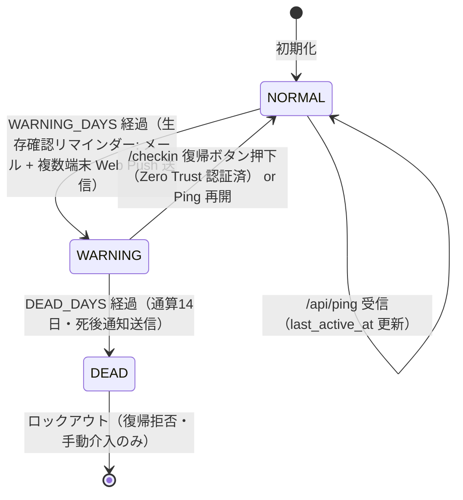

# Dead Man's Switch 要件定義書

## 1. 概要・目的

本システムは、アクティビティをパッシブ（受動的）に自動監視し、一定期間の不活動が検知された際に死後通知先メールアドレスへ死後通知（メッセージ・開示案内）を自動送信する Cloudflare Workers ベースの無償・永続型セルフホストサービス（本人専用）です。

1. **手間ゼロの受動検知**: 開発作業（Git push / ターミナル操作）やスマホ自動連携からのアクティビティを自動記録し、生存確認操作を不要にする。
2. **クラウド認証による安全な手動確認**: Cloudflare Zero Trust により保護された専用 Web ページ（`/checkin`）から、いつでも安全に最終生存状態の確認・手動復帰が行える。
3. **生存確認リマインダー & 死後通知（二段階通知）**: 不活動検知時（デフォルト: 7日目）は本人通知先メールアドレス（`OWNER_EMAIL_ADDRESS`）宛てのメールおよび登録された全端末（スマートフォンや PC の Web Push 対応ブラウザ）への Web Push で生存確認リマインダーを同時送信。通知タップ時は Zero Trust 保護された `/checkin` ページが開き安全に復帰できる。通算不活動期間（デフォルト: 14日目）経過時に死後通知先メールアドレス（`KIN_EMAIL_ADDRESS`）宛てへ死後通知メールを安全に送信する。

## 2. アーキテクチャ・ステート定義

| ステータス | 条件・概要 |
| :-- | :-- |
| **`NORMAL`** | 正常稼働状態。設定期間内にアクティビティが検知されている状態。 |
| **`WARNING`** | 応答待機状態（リマインダー送信済み）。アクティビティが途絶し、本人へ生存確認リマインダー（メール + 複数端末 Web Push）を送信して応答待機中。 |
| **`DEAD`** | 死後処理確定状態。通算規定期間（`DEAD_DAYS`）無応答のまま経過し、死後通知先メールアドレスへ死後通知を自動送信済み。**※自動復帰不可（ロックアウト）** |

## 3. 機能要件

### 3.1. エンドポイント・認証要件

- **`GET /checkin`**（Cloudflare Zero Trust 保護）
  - 本人認証（Cloudflare Zero Trust で設定された Google ログインまたは Passkey 認証）を通過したユーザーのみアクセス可能。
  - 現在のステータス（現在のステータス名、最終アクティブ日時、警告までの残り日数、Web Push 購読状況）を表示し、ワンタップで `NORMAL` へ復帰・Ping 更新を行う手動確認画面。およびアクセスした端末の Web Push 通知の購読登録（サブスクリプション取得）を行う。
  - **※ `DEAD` 状態時**: ステータス更新ボタンを無効化し、「死後処理完了済み（システムロックアウト中）」の警告メッセージ画面のみを表示して復帰を完全にブロックする。
- **`POST /api/ping`**（Cloudflare Zero Trust 保護: Service Token 認証または Access 認証）
  - 最終アクティブ日時（`last_active_at`）を更新し、`WARNING` 状態であれば `NORMAL` へ自動復帰する（※`DEAD` 状態時は `403 Forbidden` を返し拒否）。
- **`POST /api/push/subscribe`**（Cloudflare Zero Trust 保護）
  - ブラウザの Web Push サブスクリプション情報（Endpoint, Keys）を KV 内の端末リスト（`push_subscriptions`）へ追加・更新登録する。
- **`GET /api/status`**（Cloudflare Zero Trust 保護: Service Token 認証または Access 認証）
  - 現在のステータス・経過日数・設定値を JSON で返却する。

### 3.2. 不活動判定・定時チェック（Cron Trigger）

- **定時チェック**: 毎日1回自動実行。
- **12時間マージン判定**: Cron 実行時刻とハートビート送信時刻のミリ秒誤差による「1日遅延現象」を防ぐため、リマインダー判定（`WARNING_DAYS * 86400 - 43200` 秒）および死後処理判定（`DEAD_DAYS * 86400 - 43200` 秒）の両方に **12時間の許容マージン** を適用する。
- **生存確認リマインダー判定**: 不活動日数が `WARNING_DAYS`（デフォルト: 7日通算、12時間マージン含む）以上かつ `NORMAL` の場合、`WARNING` へ遷移し本人通知先メールアドレス（`OWNER_EMAIL_ADDRESS`、カンマ（半角・全角）やセミコロン区切りで複数指定可能）宛てのメールおよび登録された全端末への Web Push で生存確認リマインダーを送信。通知内のリンクおよび通知タップ時動作は `/checkin`（Zero Trust 認証付き）となる。無効になった端末サブスクリプション（410/404応答）は自動的にリストから削除される。
- **死後処理判定**: 不活動日数が `DEAD_DAYS`（デフォルト: 14日通算、12時間マージン含む）以上、ステータスが `WARNING` かつ **`warning_sent_at !== null`（生存確認リマインダーが少なくとも1回以上到達済み）** の場合、`DEAD` へ遷移し死後通知先メールアドレス（`KIN_EMAIL_ADDRESS`、カンマ（半角・全角）やセミコロン区切りで複数指定可能）へ送信元メールアドレス（`SENDER_EMAIL_ADDRESS`）より死後通知メールを送信（リマインダー未送信時の誤開示を防止）。
- **リトライおよび二重送信防止**: 送信完了日時（`warning_sent_at` / `dead_sent_at`）を独立管理し、通知送信失敗時は次回 Cron で安全に再試行しつつ二重送信を防ぐ。複数宛先への送信時は個別に並列配信を試み、少なくとも1件送信が成功した場合に送信完了日時を記録する。

## 4. 非機能要件

1. **永続性・コスト**: Cloudflare Workers + KV を使用し、完全無料枠で無期限に安定稼働すること。※ Cloudflare Email Send において、あらかじめ Cloudflare Dashboard > **Email Routing** > **Destination Addresses** にて事前認証（Verify）を完了させた送信先メールアドレス（本人通知先 `OWNER_EMAIL_ADDRESS` および死後通知先 `KIN_EMAIL_ADDRESS`）へのメール送信は、Workers Free プランを含む全プランで**完全無料かつ送信数上限のカウント対象外**として利用可能。
2. **セキュリティ**: 全エンドポイントは Cloudflare Zero Trust（ユーザーログイン認証および Service Token 認証）で一括保護し、外部からの未認証アクセス・誤操作・クローラーアクセスを100%遮断すること。Web Push 秘密鍵、送信元メールアドレス・送信先メールアドレス、死後通知本文は Wrangler Secrets / 環境変数で分離保護すること。
3. **品質保証**: Vitest (@cloudflare/vitest-pool-workers) によるローカル自動テスト環境を含むこと。

## 5. 運用上のリスク・最悪の想定への対策（ドメイン維持）

- **クレカ解約・ドメイン失効リスク**: 本人死亡時に親族によるクレジットカード解約や銀行口座凍結が行われた場合、ドメイン自動更新が失敗し、死後通知の発動前にドメインが失効してメール送信が失敗するリスクが存在する。
- **リスク回避運用アドバイス**:
  1. **長期まとめて前払い更新（推奨）**: ドメインを最長10年など数年〜10年分まとめて一括前払い契約しておくことで、クレジットカード解約・口座凍結の影響を完全に排除できる。
  2. **不活動期間（`DEAD_DAYS`）の設定**: 不活動期間を2ヶ月以上の長期に設定すると、親族の手続き完了とドメイン更新日到来のリスクが高まるため、不活動期間は14日〜30日程度に留めるか、上記の一括前払い更新と併用して設定することを推奨する。
