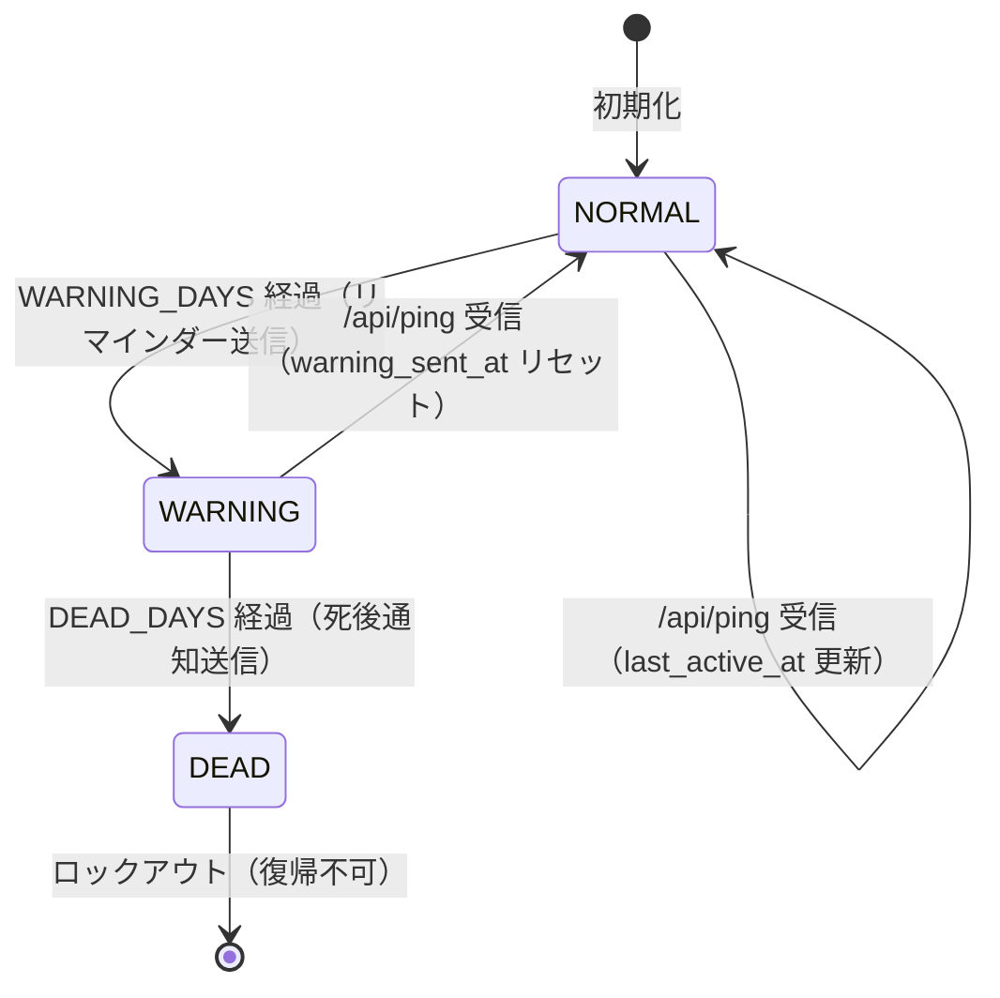

# Dead Man's Switch 要件定義書

## 1. 概要・目的

本システムは、生存シグナルの停止を自動検知し、事前設定された通知先へメールおよび Web Push を自動送信する Cloudflare Workers ベースのセルフホスト型死後通知システムです。

1. **生存シグナルの受動受信**: 外部スクリプトやクライアントからの API リクエスト（`POST /api/ping`）を受信し、最終生存確認日時を自動記録する。
2. **認証付き確認画面**: Cloudflare Zero Trust（Access）で保護された専用画面（`/`）から、ステータス確認と手動復帰が行える。
3. **二段階通知**:
   - **生存確認リマインダー**: 不活動期間が指定日数（`WARNING_DAYS`、標準7日）に達すると、本人宛メール（`OWNER_EMAIL_ADDRESS`）および登録端末へ Web Push を送信する。
   - **死後通知**: 通算不活動期間が指定日数（`DEAD_DAYS`、標準14日）に達すると、指定の通知先（`KIN_EMAIL_ADDRESS`）へメールを送信する。

## 2. ステート定義

| ステータス | 条件・説明 |
| :-- | :-- |
| **`NORMAL`** | 正常稼働状態。設定期間内に生存シグナルが検知されている状態。 |
| **`WARNING`** | 警告状態。不活動期間が `WARNING_DAYS` を超え、本人へリマインダー（メール・Web Push）を送信した状態。 |
| **`DEAD`** | 死後通知完了状態。不活動期間が `DEAD_DAYS` を超え、通知先へメール送信を完了した状態。**（自動復帰不可）** |

## 3. 機能要件

### 3.1. エンドポイント仕様

すべてのエンドポイントは Cloudflare Zero Trust（Access）で保護する。

- **`GET /`**（Access ユーザー認証）
  - 生存確認画面を返却する（Hono/JSX による SSR ＋ Vite クライアントスクリプト）。
  - 現在のステータス、最終生存確認日時（`<time>` タグとして SSR 出力し、クライアントサイドで閲覧ユーザーのブラウザタイムゾーンへ自動変換表示）、最終生存確認日からの経過日数、Web Push 購読状況を表示する。
  - `DEAD` 状態時はステータス変更ボタンを非活性化し、ロックアウト画面を表示する。
- **`POST /api/ping`**（Service Token または Access ユーザー認証）
  - 手動（生存確認画面）および外部スクリプトからの生存報告用。`last_active_at` を現在時刻に更新し、`WARNING` の場合は `NORMAL` へ復帰させて `warning_sent_at` を `null` に初期化する。
  - `DEAD` 状態時は `403 Forbidden` を返却する。
- **`POST /api/push/subscribe`**（Access ユーザー認証）
  - Web Push サブスクリプション情報を KV 内の `push_subscriptions` 配列に追加・更新する（最大20件）。
- **`DELETE /api/push/subscribe`**（Access ユーザー認証）
  - 指定された `endpoint` の Web Push サブスクリプション情報を KV から削除する。
- **`GET /api/status`**（Service Token または Access ユーザー認証）
  - 現在のステータス、最終生存確認日時、経過日数などを JSON 形式で返却する。

### 3.2. 定時判定処理（Cron Trigger）

日次 Cron Trigger（`0 0 * * *`）により以下を判定・実行する。

1. **マージン適用**: 実行時刻の誤差を考慮し、判定閾値には 12 時間のマージン（`- 43200秒`）を適用する。
2. **生存確認リマインダー判定**:
   - `status === "NORMAL"` かつ不活動時間が `WARNING_DAYS`（マージン適用）以上の場合、`status` を `WARNING` に更新する。
   - 本人アドレス（`OWNER_EMAIL_ADDRESS`）宛てメールおよび登録済みの全端末へ Web Push を送信し、成功時に `warning_sent_at` を記録する。
   - Web Push 送信時に無効（404/410）と判定された端末は登録リストから削除する。
3. **死後通知判定**:
   - `status === "WARNING"`、不活動時間が `DEAD_DAYS`（マージン適用）以上、かつ `warning_sent_at !== null`（リマインダー送信済み）の場合、`status` を `DEAD` に更新する。
   - 死後通知先（`KIN_EMAIL_ADDRESS`）宛てにメールを送信し、成功時に `dead_sent_at` を記録する。
4. **再試行処理**:
   - 通知送信に失敗した場合、次回 Cron 実行時に送信完了タイムスタンプ（`warning_sent_at` / `dead_sent_at`）が `null` であることを確認して再試行する。

## 4. 非機能要件

1. **コスト・インフラ**: Cloudflare Workers および KV を使用し、無料枠内で運用可能とする。事前認証済みの Cloudflare Email Routing 宛先へ送信することで、メール送信コストを抑える。
2. **セキュリティ**: 全エンドポイントを Cloudflare Zero Trust（Access）で保護する。秘密鍵や通知先アドレスなどの環境変数は Wrangler Secrets / 設定値として分離管理する。
3. **品質保証**: Vitest（`@cloudflare/vitest-pool-workers`）による単体・結合テストを実装する。

## 5. 運用上の注意点（ドメイン管理）

本人が死亡した際、クレジットカード解約や口座凍結によりドメイン契約が失効し、死後通知メールが送信できなくなるリスクがある。

**対策**:

- ドメイン更新期間を数年分まとめて前払い契約しておく。
- 不活動期間（`DEAD_DAYS`）をドメイン更新期限より十分短い期間（14日〜30日程度）に設定する。
